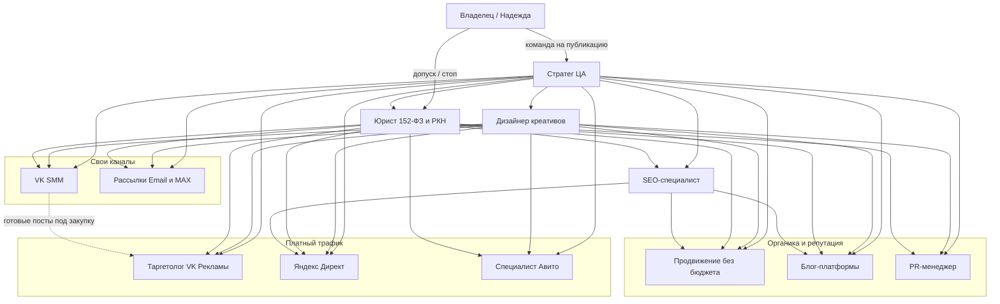

# Команда ботов «Дед Мороз 52»

Инструкции: `team/instructions/<slug>.md`. Один файл — один бот.  
Публичный контур не трогаем, пока владелец не дал команду на конкретный канал.

## Зафиксировано

| | |
|---|---|
| Продукт | Дед Мороз и Снегурочка для юрлиц Нижнего Новгорода и области |
| Сегмент | Рестораны, кафе, HR-корпоративы, площадки. Премиум. Не дом и не сад на витрине |
| Срок | До 31.12.2026 |
| Сайт | `dedmoroz52.ru` |
| ВК | `vk.ru/newyearmagic52` |
| Прайс до 01.12 | Выход 14 920 ₽ · шоу 19 920 ₽ · Welcome 24 920 ₽ · по столикам 34 920 ₽ |
| Контакт | Надежда, 8 (952) 451-65-79 |
| Оплата | Чек самозанятого, безнал. НДС / ООО / УПД не обещать |
| Позиция | Чуть дороже витрины, мероприятие не сорвём. Конкурентов не называем |
| Ценность | Формула Хармози: (результат × уверенность) / (ожидание × усилия). «Вы только называете время» |
| Боли | `research/pains-2026.md`, `teya-memory/research/` (ветка `cursor/b2b-seo-texts-email-kp-5e82`, PR #1) |
| Тексты | Короткие |
| Закон | 38-ФЗ (реклама, ERID, без спама), 152-ФЗ (ПДн). На личные адреса без согласия не пишем |

## Боты

| Бот | Файл |
|---|---|
| Стратег ЦА | [instructions/strateg-ca.md](instructions/strateg-ca.md) |
| Таргетолог VK Рекламы | [instructions/targetolog-vk.md](instructions/targetolog-vk.md) |
| Рассылки (Email и MAX) | [instructions/rassylki.md](instructions/rassylki.md) |
| Продвижение без бюджета | [instructions/prodvizhenie-bez-byudzheta.md](instructions/prodvizhenie-bez-byudzheta.md) |
| Блог-платформы | [instructions/blog-platformy.md](instructions/blog-platformy.md) |
| PR-менеджер | [instructions/pr-menedzher.md](instructions/pr-menedzher.md) |
| Специалист Авито | [instructions/avito.md](instructions/avito.md) |
| Яндекс Директ | [instructions/yandex-direct.md](instructions/yandex-direct.md) |
| VK SMM | [instructions/vk-smm.md](instructions/vk-smm.md) |
| Юрист по 152-ФЗ и РКН | [instructions/yurist-152-rkn.md](instructions/yurist-152-rkn.md) |
| SEO-специалист | [instructions/seo.md](instructions/seo.md) |
| Дизайнер креативов | [instructions/dizayner-kreativov.md](instructions/dizayner-kreativov.md) |

## Схема команды

Стратег задаёт сообщения. Юрист допускает к публикации. Дизайнер собирает макеты из живых кадров. Каналы не публикуют сами.

## Общий конвейер

1. Стратег собирает угол сегмента и боль из research.
2. Дизайнер и канал делают черновик.
3. Юрист ставит «можно / можно с правкой / стоп».
4. Пакет уходит владельцу.
5. Публикация, закупка, рассылка, ответ клиенту — **только после команды владельца**.

CTA везде одно: звонок Надежде или сообщение в `vk.ru/newyearmagic52`. Слот бот не бронирует.

## Сводные вопросы к владельцу

Без повторов. Ответов в репозитории нет — не выдумывать.

### Оффер и ёмкость

1. Сколько выходов юрлиц нужно закрыть до 31.12 и сколько пар реально выходит в пиковый день?
2. Комиссию 10–15% ресторану из `research/pains-2026.md` публикуем, говорим только управляющему или снимаем?
3. Какие цифры юрлица после 01.12, на 31.12 и ночь можно называть в рекламе?

### Домен, счётчики, карты

4. Домен `dedmoroz52.ru` куплен? Какие URL боевые, а какие только макеты `teya-memory/design/`? Индексацию включать?
5. Есть ли Метрика, Вебмастер, Search Console — ID и доступы?
6. Заведены ли Яндекс Бизнес и 2ГИС? Кто админ, какое название и телефон в карточке?

### Кабинеты и бюджеты

7. VK Реклама: кабинет, админ, дневной и сезонный бюджет, пиксель / ретаргет?
8. Яндекс Директ: кабинет, бюджет до 31.12, дневной потолок?
9. Авито: кабинет, бюджет продвижения, только B2B без «на дом», цену в карточке открыто 14 920 ₽ или «договорная»?
10. Кто отвечает в личке ВК, на Авито и по входящим площадок — Надежда или бот готовит черновики ответов?
11. Есть ли права администратора `vk.ru/newyearmagic52`? Instagram до 31.12 живой канал или только ВК?

### 152-ФЗ, РКН, 38-ФЗ

12. Оператор ПДн: ФИО самозанятого, ИНН, подано ли уведомление в РКН?
13. Политика и два согласия уже на боевом сайте? Где хранятся согласия?
14. Кто рекламодатель в ОРД и кто получает ERID для VK, Директа, Авито, email и платных постов?
15. Есть ли email-база **юрлиц** с отдельным согласием на рассылку? Откуда и когда?
16. MAX — рабочий канал (аккаунт, бот, рассылка) или до 31.12 не трогаем?
17. Через какой сервис шлём письма и можно ли отправителя на `@dedmoroz52.ru`?

### Кадры, кейсы, площадки

18. Какие файлы из `ded/` можно в рекламу и ленту (права гостей и площадок)? Нужен ли логотип сверх живого кадра?
19. Какие залы можно публично называть и с какими кадрами: Ариель, Колокол, Наршараб, Онегин, другие?
20. Куда грузить исходники креативов и картинки письма, если публичного хостинга images ещё нет?
21. В какие местные чаты можно писать от проекта? Надежда сама обзванивает площадки или достаточно таблицы касаний?
22. Какие блог-площадки разрешены (Дзен, TenChat, VC.ru, иное), есть ли авторские аккаунты, платное продвижение постов — да/нет?
23. Есть ли список локальных СМИ? Комментарий Надежды под фамилией или только «Надежда, координатор»?

## Как читать отчёт бота

В каждом файле один каркас: статус (черновик / ждёт владельца / после команды), сделано, передано соседям, блокер, вопрос, следующий шаг **без публикации**.
